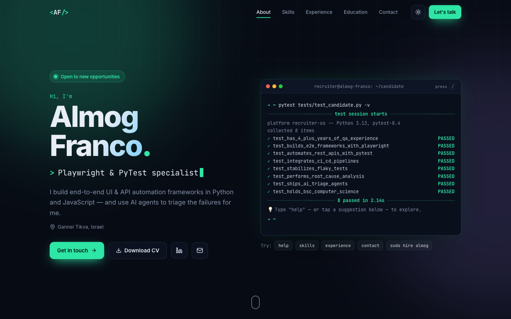

# Almog Franco — Interactive Resume

[](https://github.com/Almog-Franco/almog-portfolio/actions/workflows/ci.yml)

**Live site → [almog-portfolio-tau.vercel.app](https://almog-portfolio-tau.vercel.app)**

My resume as an interactive single-page app, built for a QA Automation Engineer. It opens by running a
"pytest" suite against me, and you can explore it from a working terminal.



## What you can do on the site

- **Run the terminal.** On load it plays `pytest tests/test_candidate.py`, then accepts commands:
  `help`, `skills`, `experience`, `contact`, `cv`, `goto <section>`, `theme`… Tab autocompletes,
  ↑/↓ browse history, and <kbd>/</kbd> focuses it from anywhere. (Try `sudo hire almog`.)
- **Click a skill to see where it was used.** The roles that used it light up in the experience timeline,
  and a floating `assert "PyTest" in experience → PASSED` bar names the companies. Tags on job cards work
  the other way round.
- **Filter skills** with a `grep -i` search box.
- **Expand roles** for the full bullet points.
- **Switch light/dark theme.** The choice is saved, with no flash on reload.
- **Copy the email in one click** or download the PDF resume.

## Tech

| Area      | Choice                                                                                                       |
| --------- | ------------------------------------------------------------------------------------------------------------ |
| Framework | Angular 22: standalone components, signals, zoneless change detection, new control flow                     |
| Styling   | Hand-written SCSS with CSS custom-property themes; no UI library (~59 kB initial transfer)                   |
| Unit      | Vitest (Angular's default runner)                                                                            |
| E2E       | Playwright: page-object model, role-based locators, data-driven from the same resume data the UI renders     |
| CI        | GitHub Actions: build → unit → E2E type-check → E2E, Playwright HTML report uploaded as an artifact          |
| Hosting   | Vercel                                                                                                       |

Accessibility: semantic landmarks, keyboard support throughout, visible focus rings, `aria-expanded`/`aria-pressed`
state, a skip link, and `prefers-reduced-motion` support (all animation is skipped).

## Testing approach

The E2E suite ([e2e/](e2e/)) treats the portfolio like a production app:

- **Page object** ([e2e/pages/portfolio.page.ts](e2e/pages/portfolio.page.ts)) keeps locators in one place.
  It prefers `getByRole`, and uses test ids only where no role fits.
- **Data-driven assertions.** Specs import [src/app/data/resume.ts](src/app/data/resume.ts), so changing
  the resume content never needs test edits. Expected skill→role matches are derived, not hard-coded.
- **Deterministic by design.** Tests run with `reducedMotion: 'reduce'`, which makes every animation finish
  instantly. The terminal exposes `aria-busy`, so tests wait on state, never on timeouts.
- **Regression tests for real bugs found while building**, e.g. consecutive terminal commands merging when
  typed faster than change detection, and collapsed job details being clipped but still "visible".
- Verified stable with `--repeat-each=3` (69/69).

## Run locally

```bash
npm install
npm start                    # http://localhost:4200

npm run test:ci              # unit tests
npx playwright install chromium
npm run e2e                  # E2E against a local production build
npm run e2e:prod             # same suite against the live Vercel site
```

## Editing content

Everything shown on the site — profile, skills, jobs, stats, the terminal's "tests" — lives in
[src/app/data/resume.ts](src/app/data/resume.ts). Replace the PDF at `public/Almog-Franco-Resume.pdf` to update
the download.

## Project structure

```
src/app/
├── data/resume.ts          # single source of truth for content
├── sections/               # hero, terminal, stats, skills, experience, education, contact, nav
└── shared/                 # icon, reveal & spotlight directives, theme/skill-focus/toast services
e2e/
├── pages/portfolio.page.ts # page object
└── *.spec.ts               # terminal, skills ↔ experience, site basics & mobile
```

---

**Almog Franco** · [almog246@gmail.com](mailto:almog246@gmail.com) ·
[LinkedIn](https://www.linkedin.com/in/almog-franco-154573177)
